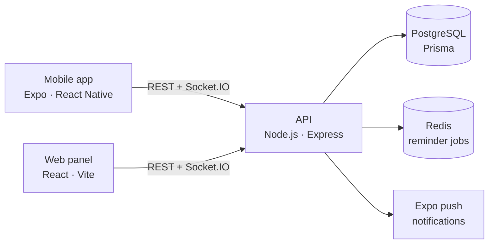

# PatiReminder

I kept losing track of my dog's vaccines and medication, and so did everyone else at home: nobody knew whether the evening pill had already been given. PatiReminder keeps a pet's health record in one place, reminds you before a vaccine is due, and shows the whole family who gave which dose and when.

> **Status:** early development. The API, database schema, auth and CI are in place; the mobile and web screens are next. See the [roadmap](#roadmap).

## Features (MVP)

- **Pet profiles:** name, species, breed, birth date, photo.
- **Vaccination record:** past shots and the next due date set by the vet, with reminders before it.
- **Medication schedule:** dosage and interval; mark each dose as given or skipped.
- **Shared with the family:** everyone in the household sees the same pets. When someone marks a dose as given, it updates for everyone in real time, so a dose is never given twice.
- **Vet visits and weight history.**
- **Health record as PDF** to hand to a vet or a pet hotel.

PatiReminder records what your vet tells you. It does not suggest vaccine schedules or give medical advice.

## Architecture



| Path | What it is |
|---|---|
| `apps/api` | Express + TypeScript API, Prisma ORM, JWT auth, Vitest + Supertest tests |
| `apps/web` | React + Vite family panel |
| `apps/mobile` | Expo (React Native) app with Expo Router |
| `packages/shared` | Zod schemas and types shared by all three apps |

A few design decisions:

- **Households, not users, own pets.** Sharing a pet with family is just adding a member to the household.
- **One row per scheduled dose** with a unique `(medicationId, scheduledFor)` constraint, so the database itself rejects a second "given" for the same dose.
- **Reminders run on the server** (Redis-backed jobs, in progress), so they arrive even when the app is closed, at the right time in each user's time zone.
- **Shared validation.** The same Zod schema checks a form on the phone and the request on the server.

## Getting started

Requirements: Node.js 22+, Docker.

```bash
npm install
npm run db:up                          # PostgreSQL on :5433, Redis on :6380
cp apps/api/.env.example apps/api/.env # then set JWT_SECRET
npm run db:migrate
npm run dev:api                        # http://localhost:4000/health
npm run dev:web                        # http://localhost:5173
npm run dev:mobile                     # Expo dev server
```

Run the checks the CI runs:

```bash
npm run typecheck
npm run lint
npm test
npm run build
```

## Roadmap

- [x] Monorepo, database schema, Docker Compose, CI
- [x] Sign-up, login, JWT auth
- [ ] Pet, vaccination and medication endpoints
- [ ] Mobile screens: pets, vaccines, medication
- [ ] Scheduled reminders and push notifications
- [ ] Household invites and real-time dose updates
- [ ] Web panel and PDF health record

## Tech stack

TypeScript · React Native (Expo) · React · Vite · Node.js · Express · PostgreSQL · Prisma · Redis · Socket.IO · Zod · Vitest · Docker · GitHub Actions
