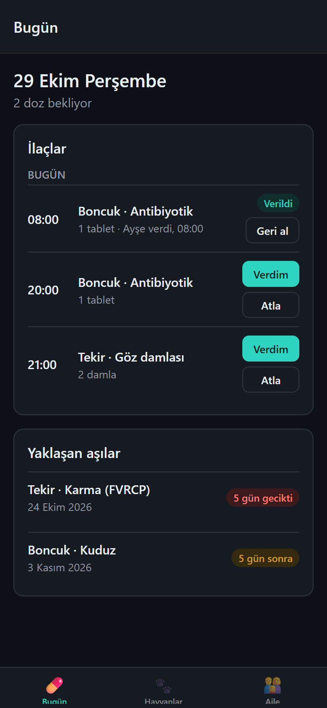
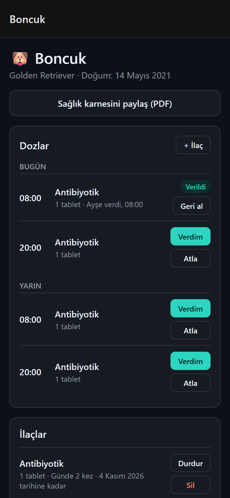
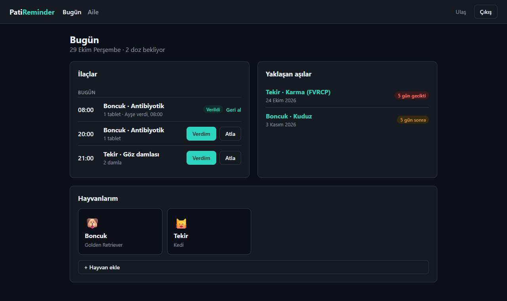
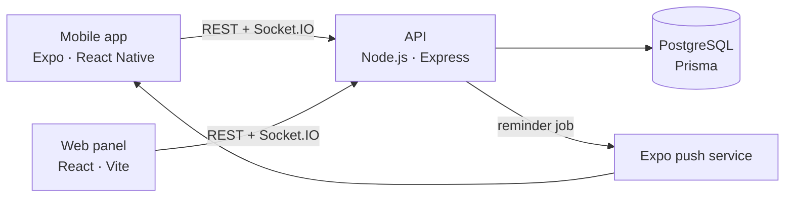

# PatiReminder

[](https://github.com/UlasUcan77/PatiReminder/actions/workflows/ci.yml)

I kept losing track of my dog's vaccines and medication, and so did everyone else at home: nobody knew whether the evening pill had already been given. PatiReminder keeps a pet's health record in one place, reminds the family before a dose or a vaccine is due, and shows everyone who gave which dose and when.

<p>
  
  
</p>


## What it does

- **Medication schedule.** Enter the dosage and how often ("twice a day", "weekly"). Today's doses show up for the whole family with **Verdim** (given) and **Atla** (skip) buttons.
- **No double doses.** When someone marks a dose as given, every open phone and browser updates instantly, the other family members get a push notification, and anyone who tries to record the same dose again is told who already gave it.
- **Vaccination record.** Past shots and the next due date set by the vet, with reminders a week before and the day before. Overdue vaccines stand out.
- **Reminders that arrive when the app is closed.** The server sends them as push notifications at dose time.
- **Shared with the family.** Invite people with a six-character code; everyone in the household sees the same pets.
- **Weight history and vet visits**, with a small weight chart on the web.
- **Health record as a PDF** to hand to a vet or a pet hotel: printed from the browser, or shared from the phone.

PatiReminder only records what your vet tells you. It does not suggest vaccine schedules or give medical advice.

## Architecture



| Path              | What it is                                                                              |
| ----------------- | --------------------------------------------------------------------------------------- |
| `apps/api`        | Express + TypeScript API, Prisma, JWT auth, Socket.IO, reminder job, Vitest + Supertest |
| `apps/web`        | React + Vite panel with React Query and React Router                                    |
| `apps/mobile`     | Expo Router app: secure token storage, push notifications, PDF sharing                  |
| `packages/shared` | Zod schemas, response types, dose schedule, typed API client, health record template    |

### Design decisions

- **Households own pets, not users.** Sharing with family is adding a member to the household. Every endpoint checks membership in one place (`apps/api/src/lib/access.ts`) and answers 404 for other households' data, so ids can't be probed.
- **Doses are computed, not stored ahead of time.** A medication is a rule: every N hours from a start time until an optional end. The slots for any range come from `doseSlots()` in the shared package. Only a dose someone records becomes a row.
- **The database prevents double dosing.** Recorded doses have a unique `(medicationId, scheduledFor)` index. If two people tap "given" at the same moment, the second insert fails, and the API answers 409 with who gave it.
- **Reminders without a queue.** A job inside the API runs every minute and works from the database alone. Each sent reminder is written to a `ReminderLog` table with a unique key, so restarting the server or running several instances never sends the same reminder twice.
- **Validation is written once.** The same Zod schemas check a form on the phone and the request on the server, and the typed API client is shared by web and mobile.
- **One PDF template for two platforms.** The health record is an HTML template in the shared package; the browser prints it, and the phone turns it into a PDF with `expo-print`.

## Getting started

Requirements: Node.js 22+ and Docker.

```bash
npm install
npm run db:up                           # PostgreSQL on localhost:5433
cp apps/api/.env.example apps/api/.env  # then set JWT_SECRET
npm run db:migrate
npm run db:seed                         # optional: demo household, see apps/api/prisma/seed.ts
```

Then, in separate terminals:

```bash
npm run dev:api      # http://localhost:4000
npm run dev:web      # http://localhost:5173
npm run dev:mobile   # scan the QR code with Expo Go or a development build
```

The mobile app talks to the API on the same machine as the Expo dev server, so a phone on the same Wi-Fi works without extra setup. Set `EXPO_PUBLIC_API_URL` to point it somewhere else.

**Push notifications** need a physical device and an EAS project: run `npx eas init` in `apps/mobile` and use a development build (`npx expo run:android` or `run:ios`). Everything else works in Expo Go.

### Checks

These are the same checks CI runs on every push:

```bash
npm run format:check
npm run typecheck
npm run lint
npm test          # API tests need the database from `npm run db:up`
npm run build
```

### Running the API in Docker

```bash
JWT_SECRET=$(node -e "console.log(require('crypto').randomBytes(48).toString('base64'))") \
  docker compose --profile full up --build
```

The container applies migrations on start, then serves on port 4000.

## Tech stack

TypeScript · React Native (Expo, Expo Router) · React · Vite · React Query · Node.js · Express · Socket.IO · PostgreSQL · Prisma · Zod · Vitest · Supertest · Docker · GitHub Actions
